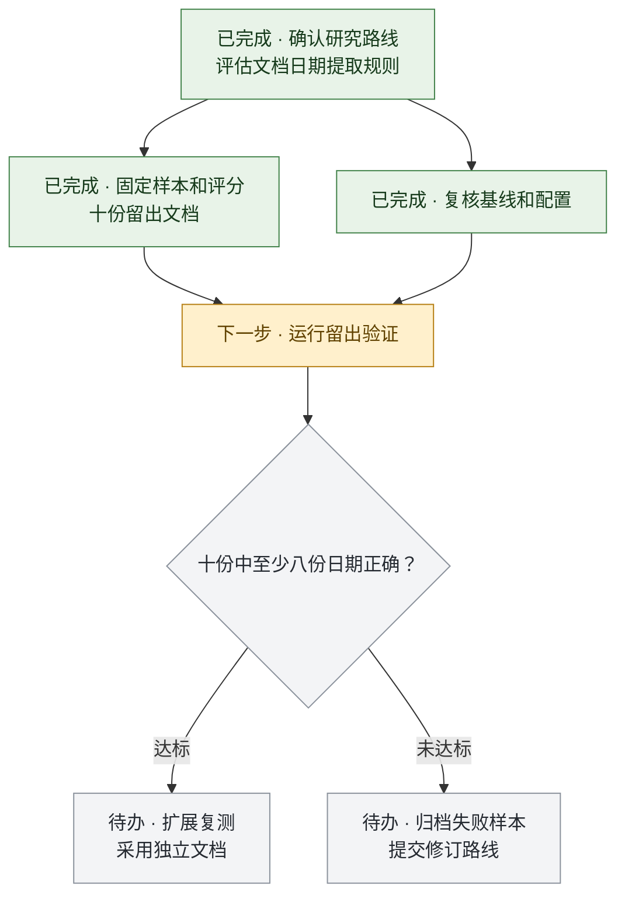

# 合作式开发与研究技能

两项可独立安装的技能，适用于支持 Agent Skills 规范的 AI 工具。用户确认关键路线与取舍，代理按任务依赖推进，记录进展、验收证据和阶段交接。[Agent Skills 规范](https://agentskills.io/specification)

| 技能 | 适用场景 | 关键记录 |
| --- | --- | --- |
| [合作式开发](skills/collaborative-development/SKILL.md) | 多阶段功能开发、重构或工程交付 | 技术取舍、任务依赖、验收结果、可恢复版本 |
| [合作式研究](skills/collaborative-research/SKILL.md) | 实验、论文复现或分阶段证据综合 | 研究协议、对照与门槛、结果及适用范围、复现入口 |

## 安装与使用

下载或克隆本仓库，从 `skills/` 下选取所需技能，将整个技能目录复制到工具的用户级或项目级技能目录，并保留原目录名。

| 工具 | 用户级目录 | 项目级目录 | 官方文档 |
| --- | --- | --- | --- |
| Codex | `~/.agents/skills/` | `.agents/skills/` | [Codex 技能](https://learn.chatgpt.com/docs/build-skills#where-codex-loads-local-skills) |
| Claude Code | `~/.claude/skills/` | `.claude/skills/` | [Claude Code 技能](https://code.claude.com/docs/en/skills#choose-where-skills-load) |
| Gemini CLI | `~/.agents/skills/` | `.agents/skills/` | [Gemini CLI 技能](https://geminicli.com/docs/cli/skills/#discovery-tiers) |
| OpenCode | `~/.agents/skills/` | `.agents/skills/` | [OpenCode 技能](https://opencode.ai/docs/skills) |

各工具从 `SKILL.md` 读取技能。以用户级安装为例，研究技能在共享目录中的入口为 `~/.agents/skills/collaborative-research/SKILL.md`。随附的 `agents/openai.yaml` 提供 Codex 的可选界面信息。

在项目会话中指定技能名，可附上现有的 README、计划或实验记录。显式调用遵循工具约定，例如 Codex 中的 `$collaborative-research` 或 Claude Code 中的 `/collaborative-research`。

- `使用 collaborative-development 为这次重构拟定路线图，说明兼容性取舍和各阶段的验收条件。`
- `使用 collaborative-research 按 README 中已确认的路线继续，汇总本轮结果和触发下一阶段的条件。`

## 路线图示例

示例中的研究路线已确认，两项准备工作可以并行。留出验证开始前先固定样本、评分规则与基线。决策节点显示测量结束后的两种去向。

绿色表示已完成，黄色表示下一步，灰色表示待办与尚待判定的门槛。项目图旁可链接实际的协议、提交、验收或结果。开发项目可采用同一图式，在汇合点执行集成验收，依据结果进入交付或修正分支。

## 阻塞与交接

单条任务线受阻时，先记录影响和恢复条件，再推进其他独立任务。所有可执行分支都受阻时，代理汇报自上次收到用户消息以来的进展、已尝试的处理方式和需要用户提供的具体帮助。阶段结束后，归档可追溯的中间版本，清理可重建且已无引用的临时文件，并记录下一次接续的位置。
